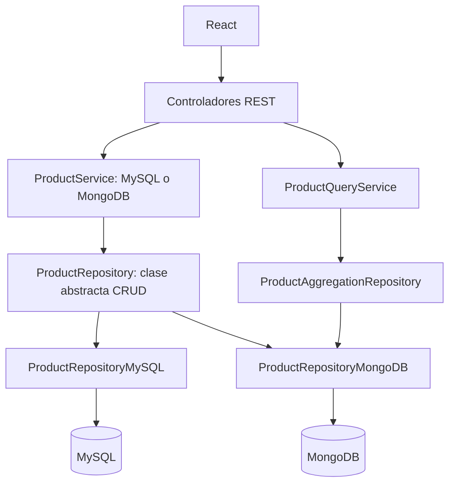

# CRUD hexagonal con MySQL y MongoDB

Taller de Programación Avanzada: administrar productos con dos tecnologías de persistencia conservando los mismos casos de uso y el contrato abstracto original. El menú de React selecciona una base real; los datos de MySQL y MongoDB son independientes.

## Tecnologías y estructura

- Backend: Java **21** como versión de compilación, Spring Boot **4.1.1**, Maven Wrapper **3.9.9**, Spring JDBC y Spring Data MongoDB.
- Frontend: React **19**, Vite **6**, JSX y CSS. Vitest y Testing Library para pruebas.
- Persistencia: MySQL **8.0.16+** (restricciones `CHECK`) y MongoDB Community. Se validó MongoDB local **8.2**.

```text
Spring_boot_crud/
  dbs/productoscruddb.sql       # Esquema MySQL original
  src/main/java/com/example/productoscrud/
    app/                       # Arranque y composición de servicios
    domain/model/              # Product sin dependencias de Spring
    application/
      ports/                   # Contrato CRUD y puerto de agregaciones
      service/                 # Casos de uso y validaciones
      query/                   # Respuesta de consulta y estadísticas
    infrastructure/
      persistence/mysql/       # JDBC y SQL parametrizado
      persistence/mongodb/     # MongoTemplate, BSON y pipelines
      web/                     # Controladores, errores y CORS
  src/test/                    # Tests unitarios, HTTP e integración separada
react_crud/
  src/App.jsx                  # Sesión del CRUD por tecnología
  src/components/              # Selector, formulario, tabla y consultas MongoDB
  src/services/api.js          # Cliente HTTP
  src/test/                    # Interacciones y respuestas tardías
docs/IMPLEMENTACION.md          # Informe de cambios y comprobaciones
```

## Arquitectura



`ProductRepository` conserva sus cinco métodos: `listar`, `buscarPorId`, `crear`, `actualizar` y `eliminar`. Ambos adaptadores extienden esta clase. `ProductService` valida el dominio y delega en el contrato; no conoce JDBC ni MongoTemplate. MySQL mantiene `SimpleJdbcInsert`, su ID autoincremental y el esquema original.

`App` conecta dos instancias del mismo servicio mediante `@Qualifier`. El controlador selecciona explícitamente el servicio según la ruta. No hay otra fábrica abstracta ni `@Primary`. Las cuatro consultas utilizan un puerto adicional, específico para las capacidades de agregación; no agregan métodos MongoDB al contrato CRUD existente.

El adaptador MongoDB usa documentos BSON internos y los convierte a `Product`. Conserva `Integer id` en REST y lo almacena como `_id`. El cliente no determina el ID de creación. La colección `counters`, documento `_id: "products"`, reserva `seq` con `findAndModify`, `$inc`, `upsert` y `returnNew`. El índice único de `_id` protege frente a duplicados. Si existen IDs importados sin contador, la creación salta colisiones con hasta 100 reservas atómicas. Los contadores pueden dejar huecos tras errores o eliminaciones.

Los importes se almacenan como `Decimal128` y se convierten directamente a/desde `BigDecimal`, sin pasar por `double`. Los filtros usan el mismo tipo decimal. El dominio conserva sus reglas: nombre obligatorio de hasta 100 caracteres, precio no negativo y descripción no nula de hasta 255 caracteres (omitida en JSON toma `""`).

## Preparar MySQL

1. Instala MySQL Server y, opcionalmente, MySQL Workbench. Inicia el servicio local en el puerto **3306**.
2. Ejecuta manualmente [productoscruddb.sql](Spring_boot_crud/dbs/productoscruddb.sql) en Workbench. Crea `productoscruddb.products` y solo añade ejemplos si la tabla está vacía. No elimina datos existentes.
3. Define tus credenciales en la terminal que iniciará el backend:

```powershell
$env:DB_USER = "root"
$env:DB_PASSWORD = "TU_CLAVE_LOCAL"
```

La contraseña predeterminada está vacía; configura la que corresponda a tu instalación. No guardes credenciales en Git.

## Instalar MongoDB en Windows 11

1. Descarga el instalador MSI de MongoDB Community desde el [sitio oficial](https://www.mongodb.com/try/download/community).
2. Ejecuta el asistente, selecciona la instalación completa y la opción **Install MongoD as a Service**. Conserva la escucha local en **27017**. Puedes instalar Compass para inspeccionar documentos.
3. Instala `mongosh` por separado si deseas usar la consola: no forma parte del MSI del servidor. Sigue la [guía oficial de instalación para Windows](https://www.mongodb.com/docs/manual/administration/install-community-windows/?win-method=wizard).
4. Comprueba el servicio en PowerShell (iniciarlo puede requerir una terminal de administrador):

```powershell
Get-Service MongoDB
# Solo si está detenido:
Start-Service MongoDB
mongosh "mongodb://localhost:27017/productoscrudmongo" --eval 'db.runCommand({ping:1})'
```

No es necesario crear colecciones: el primer producto crea `products` y `counters`. La conexión local prevista no usa autenticación. Para una instalación autenticada, proporciona tu URI mediante `MONGO_URI`, sin publicarla.

Si importas productos con IDs explícitos, conserva `price: NumberDecimal("...")` y sincroniza el contador antes de poner en uso la importación. Para una importación cuyos IDs llegan hasta 5:

```javascript
// En mongosh, conectado a productoscrudmongo. No reduce un contador existente.
db.counters.updateOne({ _id: "products" }, { $max: { seq: NumberLong(5) } }, { upsert: true })
```

El archivo local `dbs/productoscrudmongo.db`, si está presente, contiene ejemplos de mongosh y no se ejecuta automáticamente.

## Ejecutar las aplicaciones

Necesitas un JDK 21 o superior, con `JAVA_HOME` apuntando al directorio del JDK y no a `bin`. La compilación genera bytecode Java 21. Para el frontend y sus herramientas de pruebas utiliza Node.js **22.13+** o **24 LTS**, con npm.

En una terminal, desde la raíz:

```powershell
cd Spring_boot_crud
$env:MONGO_URI = "mongodb://localhost:27017/productoscrudmongo"
.\mvnw.cmd spring-boot:run
```

En otra terminal, desde la raíz:

```powershell
cd react_crud
npm ci
npm run dev
```

Abre **http://127.0.0.1:5175**. El backend escucha en **8081**. El menú muestra la persistencia activa y permite crear, listar, editar y eliminar en ambas bases. MongoDB añade los cuatro filtros con resultados, código y botón de copia. Cambiar de tecnología limpia el formulario, cancela las peticiones anteriores y evita mostrar sus respuestas tardías. Las mutaciones limpian las consultas anteriores para evitar resultados desactualizados.

Para compilar React: `npm run build`; el resultado queda en `react_crud/dist`. Para cambiar la API, copia `react_crud/.env.example` a `.env.local`, ajusta `VITE_API_URL` y reinicia Vite. Spring no carga automáticamente archivos `.env`: sus variables se definen en la terminal o en el IDE.

| Variable | Valor predeterminado / propósito |
| --- | --- |
| `DB_HOST` | `localhost` |
| `DB_PORT` | `3306` |
| `DB_NAME` | `productoscruddb` |
| `DB_USER` | `root` |
| `DB_PASSWORD` | Vacío; define tu contraseña |
| `MONGO_URI` | `mongodb://localhost:27017/productoscrudmongo` |
| `CORS_ALLOWED_ORIGINS` | `http://127.0.0.1:5175,http://localhost:5175` |
| `SERVER_PORT` | `8081` |
| `VITE_API_URL` | `http://127.0.0.1:8081` |

La propiedad `spring.mongodb.uri` corresponde a Spring Boot 4.1.1; véase su [documentación de configuración](https://docs.spring.io/spring-boot/appendix/application-properties/index.html). CORS permite únicamente los orígenes configurados y los métodos necesarios.

## API CRUD

Usa una de estas bases: `/api/mysql/productos` o `/api/mongodb/productos`. El alias original `/productos` continúa utilizando MySQL.

| Método | Ruta relativa a la base | Respuesta |
| --- | --- | --- |
| GET | Vacía o `/` | 200, lista de productos |
| GET | `/{id}` | 200 o 404 |
| POST | Vacía o `/` | 201, producto con ID generado |
| PUT | `/{id}` | 200 o 404 |
| DELETE | `/{id}` | 204 o 404 |

IDs no positivos, productos inválidos, JSON incorrecto y parámetros inválidos reciben **400**. Las restricciones de persistencia reciben **409** y los errores de acceso a bases de datos **503**. Los errores controlados devuelven `{ "message": "..." }` sin detalles de conexión.

```powershell
$base = "http://127.0.0.1:8081/api/mongodb/productos"
$body = @{ name = "Mouse USB"; price = "45000.10"; description = "Ejemplo" } | ConvertTo-Json
$producto = Invoke-RestMethod -Method Post -Uri $base -ContentType "application/json" -Body $body
Invoke-RestMethod "$base/$($producto.id)"
Invoke-RestMethod -Method Put -Uri "$base/$($producto.id)" -ContentType "application/json" -Body $body
# Elimina únicamente el producto creado en este ejemplo:
Invoke-RestMethod -Method Delete -Uri "$base/$($producto.id)"
```

El precio admite números JSON y cadenas decimales. React envía una cadena decimal para conservar exactamente la entrada del formulario; la respuesta mantiene el contrato original de `BigDecimal` como número JSON.

## Cuatro pipelines

Todas las rutas parten de `/api/mongodb/productos/filtros`. Cada respuesta contiene `filtro`, `resultados` y `pipeline`, un arreglo Extended JSON generado a partir de las mismas etapas ejecutadas. React muestra y copia ese arreglo. El usuario solo puede enviar parámetros de los filtros permitidos, nunca operadores arbitrarios.

| Ruta | Parámetros y reglas | Etapas |
| --- | --- | --- |
| `/nombre` | `texto`, 1–100 caracteres; búsqueda literal sin distinguir mayúsculas | `$match`, `$sort` por `_id`, `$limit: 100` |
| `/precios` | `minimo`, `maximo`; `0 <= minimo <= maximo` | `$match` decimal inclusivo, `$sort` por precio e ID, `$limit: 100` |
| `/costosos` | `limite`, entero 1–100, predeterminado 5 | `$sort` por precio descendente e ID, `$limit` |
| `/estadisticas` | Ninguno | `$group`: cantidad, promedio, mínimo y máximo |

La búsqueda por nombre utiliza `Pattern.quote`: entradas como `.*` se buscan literalmente. Los empates de precio se ordenan por ID para obtener resultados estables. Todas las agregaciones tienen un tiempo máximo de ejecución de 10 segundos. Las estadísticas no tienen límite de documentos de entrada porque deben considerar todo el catálogo.

Ejemplo de respuesta real para `precios?minimo=10000&maximo=100000` (los resultados dependen de tus datos):

```json
{
  "filtro": "precios",
  "resultados": [],
  "pipeline": [
    { "$match": { "price": { "$gte": { "$numberDecimal": "10000" }, "$lte": { "$numberDecimal": "100000" } } } },
    { "$sort": { "price": 1, "_id": 1 } },
    { "$limit": 100 }
  ]
}
```

```powershell
$filtros = "http://127.0.0.1:8081/api/mongodb/productos/filtros"
Invoke-RestMethod "$filtros/nombre?texto=mouse" | ConvertTo-Json -Depth 20
Invoke-RestMethod "$filtros/precios?minimo=10000&maximo=100000" | ConvertTo-Json -Depth 20
Invoke-RestMethod "$filtros/costosos?limite=5" | ConvertTo-Json -Depth 20
Invoke-RestMethod "$filtros/estadisticas" | ConvertTo-Json -Depth 20
```

Una colección vacía devuelve `[]` en los filtros de productos. Las estadísticas devuelven una fila con `cantidad: 0` y precios `null`; React muestra «Sin datos». Para reutilizar el código copiado en mongosh, conviértelo con `EJSON.parse` y pásalo a `db.products.aggregate(...)`: así conserva `$numberDecimal`.

## Pruebas

Las pruebas habituales no requieren servidores de bases de datos. Incluyen dominio, servicios, adaptador SQL en H2 con modo MySQL, adaptador MongoDB con mocks, correspondencia del pipeline, HTTP, CORS y arranque Spring con ambos repositorios.

```powershell
cd Spring_boot_crud
.\mvnw.cmd test
.\mvnw.cmd compile
cd ../react_crud
npm ci
npm test
npm run build
```

Las integraciones se ejecutan aparte con Failsafe. MongoDB crea bases únicas `productoscrud_test_<uuid>` y elimina exclusivamente esas bases al terminar. Requiere un usuario con permisos para crearlas y eliminarlas:

```powershell
cd Spring_boot_crud
$env:MONGO_TEST_URI = "mongodb://127.0.0.1:27017/?serverSelectionTimeoutMS=5000"
.\mvnw.cmd -Pintegration verify
```

Para probar también un servidor MySQL real, define las siguientes variables antes del comando. `MYSQL_TEST_URL` debe apuntar al servidor **sin nombre de base**. El test crea y elimina su propio esquema `productoscrud_test_<uuid>`; no utiliza `productoscruddb`.

```powershell
$env:MYSQL_TEST_URL = "jdbc:mysql://127.0.0.1:3306/"
$env:MYSQL_TEST_USER = "USUARIO_DE_PRUEBAS"
$env:MYSQL_TEST_PASSWORD = "CLAVE_DE_PRUEBAS"
```

Sin `MYSQL_TEST_URL`, esa integración se omite explícitamente. Las integraciones MongoDB verifican CRUD real, los cuatro pipelines, decimales, IDs concurrentes, IDs importados y aislamiento respecto al adaptador SQL ejecutado en H2.

## Limitaciones y problemas locales

- En esta máquina, Windows bloqueó el renombrado del JAR durante `spring-boot:repackage`. `test` y `compile` funcionan sin `clean`. Para ejecutar integraciones sin empaquetar, usa `.\mvnw.cmd -Pintegration test-compile failsafe:integration-test failsafe:verify`. No elimines procesos Java indiscriminadamente; identifica primero el proceso que mantiene el archivo abierto.
- El wrapper incluye una corrección para carpetas `.m2` normales cuyo atributo `Target` es nulo en PowerShell de Windows. Si Maven indica que `JAVA_HOME` es incorrecto, configura el JDK en esa terminal.
- MySQL conserva su precisión original `DECIMAL(12,2)`; MongoDB usa el rango de `Decimal128`. El formulario trabaja con pasos de 0.01. No se modifica el esquema SQL ni se migran datos entre bases.
- Los listados CRUD originales no tienen paginación. Los filtros MongoDB de nombre/precio devuelven los primeros 100 resultados y las estadísticas abarcan todo el catálogo.
- Importaciones manuales deben mantener `_id` entero, precios `Decimal128` y sincronizar `counters`; no se incluye una migración automática de documentos de terceros. La recuperación de colisiones de IDs está acotada a 100 intentos por creación.
- Cancelar una petición en React evita respuestas obsoletas; una escritura que el servidor ya recibió puede completarse. Al volver a esa base se consulta su estado actual.
- La copia automática requiere un contexto seguro (localhost es válido). Si el navegador la deniega, el bloque puede seleccionarse manualmente.
- La aplicación es un taller local sin autenticación. La integración contra MySQL real requiere credenciales de pruebas; H2 no sustituye la validación de todos los comportamientos de un servidor MySQL.

El [informe de implementación](docs/IMPLEMENTACION.md) registra archivos, decisiones, comandos y resultados. El trabajo permanece en `feature/mongodb-persistence`; la publicación en GitHub requiere autorización explícita para hacer push.
